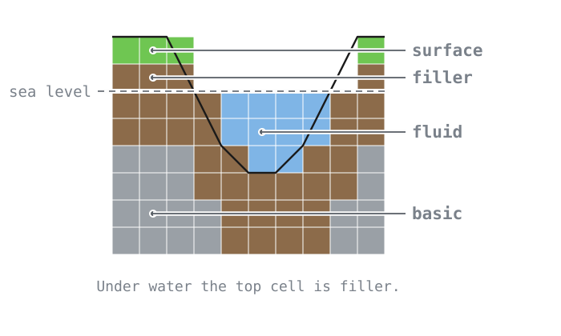

# Biomes API

Mods register biome types for the world generator.

## Constant: null biome

`biomes.NULL_BIOME` is an empty, undefined, or otherwise invalid biome ID. Treat it as a void biome for gameplay and gamedev.

## Functions

### Function: `biomes.add(name, def) -> integer`

Registers a new biome.

#### Arguments

- `name` is the namespaced biome ID
- `def` is the biome definition table

#### Return value

Returns the numeric biome ID. When the name is already taken, the engine appends `~N`, logs a warning and registers the renamed biome.

## Biome definition

|Field|Type|Required|Default|Description|
|----|----|----|----|----|
|`temperature`|`number`|no|15.0|Base temperature in degrees Celsius|
|`humidity`|`number`|no|50.0|Relative humidity, 0 to 100 percent|
|`palette`|`table`|no|`{}`|Biome block palette|
|`scatter`|`table[]`|no|`{}`|List of features to scatter|
|`tints`|`table`|no|`{}`|Tint group override colors|

## Palette table

The figure shows a cut through the terrain. The land fields fill it from the top down. The shore fields take over in the band around sea level.



|Field|Description|
|----|----|
|`base`|Block deep below the surface, eg `builtin:stone`|
|`land_filler`|Block below the land surface, eg `builtin:dirt`|
|`land_surface`|Block on top of dry land, eg `builtin:grass`|
|`fluid`|Fluid block that fills the ground below sea level, eg `builtin:water`|
|`shore_surface`|Block on top of the shore, eg `builtin:sand`|
|`shore_filler`|Block below the shore surface, eg `builtin:sand`|

Every field is optional. The `vox2` generator fills a missing field from another field:

- `base` falls back to `land_filler`, then to `land_surface`.
- `land_filler` falls back to `base`.
- `land_surface` falls back to `land_filler`.
- `shore_surface` falls back to `land_surface`.
- `shore_filler` falls back to `land_filler`.
- `fluid` has no fallback. Without it, the generator fills no cell with a fluid.

The `superflat` generator reads `land_surface`, `land_filler` and `base` as they are. It has no fallback.

## Palette entry

|Field|Type|Required|Default|Description|
|----|----|----|----|----|
|`name`|`string`|yes|N/D|Block name|
|`states`|`table`|no|`{}`|Block states|

## Scatter entry

The engine evaluates scatter entries in list order. If several entries pass the roll on the same column, **the last entry in the list wins**. The engine skips the other entries for that column. Only the `vox2` generator places scatter; `superflat` ignores it.

|Field|Type|Required|Default|Description|
|----|----|----|----|----|
|`feature`|`string`|yes|N/D|Feature to place|
|`chance`|`number`|no|0.5|Chance of a placement attempt per column|
|`need_above`|`integer[]`|no|`{}`|List of `blocks.TAG_XXXX` constants. The block above the origin must have at least one listed tag|
|`need_below`|`integer[]`|no|`{}`|List of `blocks.TAG_XXXX` constants. The origin block (surface) must have at least one listed tag|
|`padding`|`integer`|no|0|Minimum block clearance between this feature's bounding box and another placement in the same padding family. The engine uses expanded-box separation: it grows the current box by `padding` blocks, then tests for intersection|
|`group`|`string`|no|`""`|Padding family name. Entries with the same non-empty `group` share padding. An empty group pads only against the same scatter entry|
|`edge`|`integer`|no|0|Extra blocks beyond the feature's XZ bounds that must still belong to the same biome. The engine always checks the feature AABB footprint. `edge` grows that check, so large decorations stay clear of biome borders|

## Example

```lua
biomes.add("plains", {
  temperature = 20,
  humidity = 60,

  palette = {
    base = { name = "stone" },
    land_filler = { name = "dirt" },
    land_surface = { name = "stone_slab", states = { orientation = "bottom" } },
    fluid = { name = "water" },
    shore_surface = { name = "sand" },
    shore_filler = { name = "sand" },
  },

  scatter = {
    {
      feature = "oak_tree",
      chance = 0.0625,
      need_above = { blocks.TAG_GAS },
      need_below = { blocks.TAG_TURF },
    },
    {
      feature = "bush",
      chance = 0.25,
      need_above = { blocks.TAG_GAS },
      need_below = { blocks.TAG_TURF },
    }
  }
})
```

## Biome selection

A biome does not carry climate coordinates. A world defines how the engine picks a biome through the `biome_selector` of its [world definition](../worlds.md#biome-selector).

The `vox2` generator samples two climate noises, temperature and humidity. It then picks the biome whose target point in that two-axis space is nearest, weighted per axis. The selector's `entries` list the participating biomes and their target coordinates (0 to 99 per axis). `priority` breaks a tie, and `offset` biases the distance. During world load the engine nudges colliding targets until each is unique.

A world names a biome by its full identifier, so a mod biome needs its namespace. See [World definitions](../worlds.md#biome-selector).

The `vox2` generator also accepts the `grid` strategy: two axes, `grid_size`, and a `lookup` table of biome names. See [World definitions](../worlds.md#grid).

The `temperature` and `humidity` of a biome also feed the [precipitation selection](precip.md). A precipitation type names climate bands, and the engine picks the type that fits the block.
