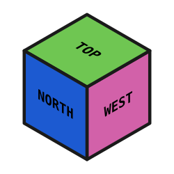
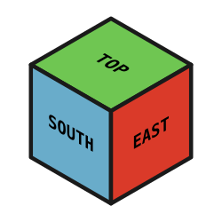
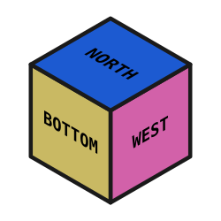
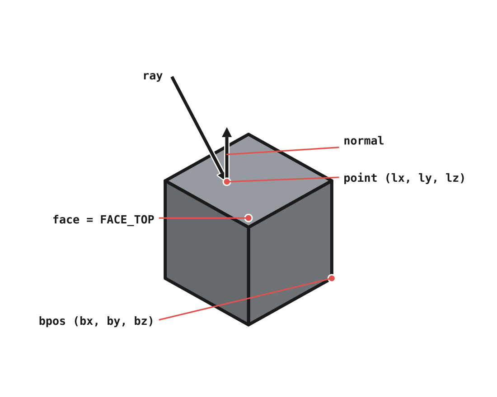

# Blocks API

Mods register new block types and read existing ones through the `blocks` library.

## Constants: render mode

Defines a block rendering step.

|Name|Description|
|----|----|
|`blocks.RENDER_NONE`|The engine draws no geometry (e.g. air)|
|`blocks.RENDER_SOLID`|The engine draws the block as opaque, cullable geometry|
|`blocks.RENDER_ALPHA`|The engine draws the block as translucent geometry|

## Constants: block face

Defines a block face used for culling and other grid-aligned operations.

|Name|Description|
|----|----|
|`blocks.FACE_NORTH`|North face|
|`blocks.FACE_SOUTH`|South face|
|`blocks.FACE_EAST`|East face|
|`blocks.FACE_WEST`|West face|
|`blocks.FACE_TOP`|Top or upper face|
|`blocks.FACE_BOTTOM`|Bottom or lower face|
|`blocks.FACE_UP`|Same as `blocks.FACE_TOP`|
|`blocks.FACE_DOWN`|Same as `blocks.FACE_BOTTOM`|

## Constants: tool conditionals

Defines a tool category used for block interactions.

|Name|Description|
|----|----|
|`blocks.TOOL_NONE`|Bare hands|
|`blocks.TOOL_BLADE`|A bladed tool (eg. sword, knife)|
|`blocks.TOOL_XBLADE`|A multi-bladed tool (eg. scissors)|
|`blocks.TOOL_AXE`|Axe-like tool|
|`blocks.TOOL_HOE`|Hoe-like tool|
|`blocks.TOOL_SHOVEL`|Shovel-like tool|
|`blocks.TOOL_HAMMER`|Hammer-like tool|
|`blocks.TOOL_PICK`|Pickaxe-like tool|

## Constants: category bits

Freeform grouping tags checked at runtime with `blocks.has_tag`. Any block can carry any number of tags via the `tags` registration field.

|Name|Description|
|----|----|
|`blocks.TAG_GAS`|Non-solid, passable block (eg. air)|
|`blocks.TAG_ROCK`|Stone-family block. Used by tools and worldgen that check for rock|
|`blocks.TAG_SOIL`|Soil-type block. Dirt, mud, and similar blocks go here|
|`blocks.TAG_TURF`|Turf-type block. Grass and similar blocks go here|
|`blocks.TAG_XFOIL`|Non-solid foliage: grass, bushes, and similar|
|`blocks.TAG_SFOIL`|Solid foliage: leaves and similar|
|`blocks.TAG_WOOD`|Wooden blocks|

## Constants: schedule source

The engine issues a scheduled tick after a specific timeout, not at random. Scheduled ticks can come from different sources.

|Name|Description|
|----|----|
|`blocks.TICK_RANDOM`|Random tick|
|`blocks.TICK_NEIGHBOUR`|Neighbouring block changed|
|`blocks.TICK_SCRIPTED`|Scripted tick|

## Constant: null block

`blocks.NULL_BLOCK` is an empty, undefined, or otherwise invalid block ID. Treat it as a void block for gameplay and gamedev.

## Functions

### Function: `blocks.get(name) -> integer`

Retrieves a numeric block stem ID from a namespaced block ID.

#### Arguments

- `name` is a namespaced block ID, eg. `mymod:coolblockname`

#### Return value

- Numeric block ID on success
- `blocks.NULL_BLOCK` if the block is missing or the namespace ID has an invalid form

#### Notes

- If a block defines `states`, the return value is a _stem_ ID. The engine does not render, collide with, or raycast a stem placed in the world.

### Function: `blocks.has_tag(id, tag) -> boolean`

Checks if a block has a specified tag.

#### Arguments

- `id` is a numeric block ID
- `tag` is a tag constant, eg. `blocks.TAG_SOIL`

#### Return value

- `true` if the block has the specified tag, `false` otherwise

### Function: `blocks.is_replaceable(id) -> boolean`

Checks if a block ID can be overwritten without breaking it first (empty cell, or `replaceable = true` at registration).

#### Arguments

- `id` is a numeric block ID (stem or variant), or `blocks.NULL_BLOCK` for an empty cell

#### Return value

- `true` if another block may occupy the cell, `false` otherwise

### Function: `blocks.add(name, def) -> integer`
### Function: `blocks.add(name, prototype, def) -> integer`

Registers a new block in the registry.

#### Arguments

- `name` is a namespaced block ID, eg `mymod:coolblockname`
- `def` is a block definition table (see below)
- `prototype` (3-argument form) is a base definition shared across a family of blocks (eg. all stone variants). `def` merges on top of `prototype`. On conflict, fields in `def` win.

#### Return value

Returns the numeric block ID.

#### Notes

**Rename rule:** on conflict, the engine adds a `~N` suffix to the encroaching `name`. `N` is the smallest integer, starting at `1`, that gives a free id (e.g. `mymod:myblock~1`). Loading stays deterministic for the same mod list and order.

## Block definition

|Field|Type|Required|Default|Description|
|----|----|----|----|----|
|`render`|`integer`|no|`blocks.RENDER_NONE`|One of `blocks.RENDER_XXXX` constants|
|`albedo`|`table`|depends|`{}`|Albedo textures to attach to the block model|
|`masks`|`table`|no|`{}`|Mask textures to attach to the block model|
|`animated`|`boolean`|no|`false`|If true, the engine treats the `albedo` slots as animation frames instead of world-position random frames|
|`model_name`|`string`|depends|N/D|[Block model](../formats/bmodel.md) name for this variant|
|`model_offset`|`number[3]`|depends|`{0, 0, 0}`|Offset of the resolved block model|
|`model_facing`|`integer`|no|`blocks.FACE_NORTH`|One of `blocks.FACE_XXXX`. Sets where the model's own north face points, and rotates the whole resolved block model|
|`bcoll_name`|`string`|depends|N/D|[Block collision](../formats/bcoll.md) shape for this variant|
|`bcoll_offset`|`number[3]`|depends|`{0, 0, 0}`|Block collision offset|
|`bcoll_facing`|`integer`|no|`blocks.FACE_NORTH`|One of `blocks.FACE_XXXX`. Rotates the resolved collision shape the same way `model_facing` rotates the model. You can set it independently of `model_facing`. The collision shape does not need to match the visual, though it usually should|
|`fluid_name`|`string`|no|N/D|[Fluid](fluids.md) name that shares the grid cell with the block|
|`fluid_level`|`integer`|no|fluid `full_level`|Fluid level when `fluid_name` is present, in 1/16ths of a block. When omitted, the engine uses the fluid's `full_level`|
|`fluid_faces`|`integer`|no|`0`|Bitmask of faces a fluid may enter or leave this variant through, made of `blocks.FACE_*` bits. `0` means no face|
|`fluid_falling`|`boolean`|no|`false`|If true, the engine treats the fluid in this cell as falling. The cell uses the flowing texture at every level, and the flow points down|
|`health`|`integer`|no|`0`|Base hit points needed to break the block|

> **NOTE:** this is planned. The engine stores `health`, but nothing reads it yet: a hit clears the cell at once.
|`sound`|`string`|no|N/D|Sound set for this block|
|`emission`|`integer`|no|`0`|Emission light value, from `0` to `15`. The engine clamps values outside the range|
|`dissipation`|`integer`|no|`0`|Opacity of the block, from `0` to `15`. Light loses this many levels when it passes through. The engine clamps values outside the range. The engine treats a `RENDER_SOLID` block with `0` dissipation as fully opaque. The block absorbs light across every cell face that its collision bounds touch, so a shape whose bounds fill the cell is opaque even when its geometry has a notch|
|`collidable`|`boolean`|no|`true`|If true, the engine uses the collision shape to stop entity movement. A fluid does not pass through the block|
|`selectable`|`boolean`|no|`true`|If true, a raycast can hit the block for selection and placement|
|`friction`|`number`|no|`0.6`|Surface friction. A lower value makes the surface more slippery. The value must be greater than zero|
|`speed`|`number`|no|`1.0`|Walk speed multiplier on this surface. The value must not be negative|
|`bounce`|`number[3]`|no|`{0, 0, 0}`|Restitution on the X, Y and Z axes. The engine reflects the movement along a contacted axis and scales it by this value|
|`tags`|`integer[]`|no|`{}`|Block tags|
|`tools`|`integer[]`|no|`{}`|Tool bits that may drop this block, made of `blocks.TOOL_*` values|
|`replaceable`|`boolean`|no|`false`|If true, other blocks can be placed into this cell without breaking it first|
|`states`|`table`|no|`{}`|Blockstates table|
|`variants`|`table[]`|no|`{}`|Variants table|
|`on_tick`|`function`|no|`nil`|Scheduled tick handler|
|`on_place`|`function`|no|`nil`|Placement handler. Can allow or deny placement|
|`on_break`|`function`|no|`nil`|Break handler|
|`on_interact`|`function`|no|`nil`|Interaction handler|

#### Where callbacks run

|Callback|Runs on|
|----|----|
|`on_place`, `on_break`|Both sides. The client predicts, the server decides|
|`on_tick`|Server only|
|`on_interact`|Server only. The engine does not call it yet|

### Movement response

`collidable` controls collision with entities and the flow of fluids. A block with `collidable = false` does not stop movement, and a fluid passes through it. `selectable` controls selection and placement. A raycast can hit a selectable block even when the block is not collidable, as a bush is. A block without a collision shape is not selectable, because the raycast needs the shape.

The surface fields apply to an entity in walk mode:

- `friction` scales the horizontal velocity and the walk acceleration. The default `0.6` matches the walk friction of the engine. A lower value makes the surface slippery like ice. A higher value stops the entity faster.
- `speed` multiplies the horizontal walk input. The value `0` removes the ground input.
- `bounce` gives the restitution for a contact along each axis. The engine reflects the movement along the contacted axis and multiplies it by the value. The value `0` stops the movement, and `1` keeps its speed.

The `touch` and `touch_coeffs` fields and the `TOUCH_*` constants no longer exist. An old script that still sets them loads, and the engine ignores the values.

### Textures

#### Albedo

Each texture slot is a list of textures. The engine uses them as position-randomized variations, or as animation frames when `animated` is `true`.


#### Masks

Each texture slot can have a mask texture that the engine uses for certain purposes. Each color channel of an RGBA mask texture can drive per-face logic, and more channels will gain this role in the future.

|Channel|Designation|Description|
|----|----|----|
|Red|Tint mask|The shader multiplies the tint color with this value|
|Green|Unused|N/A|
|Blue|Unused|N/A|
|Alpha|Unused|N/A|

### Facing rotation

`model_facing` and `bcoll_facing` each define one 90-degree-step rotation of the whole model or collision shape. They set where the north face of the model points. By default, the north face points world north.

|Value|Rotation|Image|
|----|----|----|
|`blocks.FACE_NORTH`|None||
|`blocks.FACE_SOUTH`|180 degrees around Y||
|`blocks.FACE_EAST`|-90 degrees around Y||
|`blocks.FACE_WEST`|+90 degrees around Y||
|`blocks.FACE_TOP`|-90 degrees around X||
|`blocks.FACE_BOTTOM`|+90 degrees around X||

### Drops table

```lua
drops = {
  {
    when = { effects = { "silk_touch" } },
    items = {
      { name = "stone", count = 1 }
    }
  },
  {
    -- entries without a `when` always match; put fallback
    -- entries last since matching stops at the first hit
    items = {
      { name = "cobblestone", count = 1 }
    }
  }
}
```

> **NOTE:** this is planned. The engine stores the entries and their conditions, but nothing selects a drop yet, and no effect state exists that a `when` clause could match.

### States table

```lua
states = {
  <state_name> = {
    default = "<default_state>",
    hint = { "<value_a>", "<value_b>", ... }  -- optional
  }
}
```

The engine stores blockstate values as hashed strings. You can write any value via `world.set_state`. `hint` does not restrict this at runtime.

> **NOTE:** this is planned. `hint` is stored but never checked, so a typo such as `orientation = "bottum"` passes without a warning. The check is meant to compare every `when` clause against the union of the `hint` lists and warn at load time.

### State object

|Field|Type|Required|Default|Description|
|----|----|----|----|----|
|`default`|`string`|yes|N/D|Default blockstate value|
|`hint`|`string[]`|no|`{}`|Optional list of valid values for registration-time validation|

### Variants

```lua
variants = {
  {
    when = { <state_name> = "<state_value>" },
    overrides = {
      model_name = "slab_top",
      bcoll_offset = { 0, 8, 0 },
      health = 2,
      replaceable = true,
      drops = { ... }
    }
  }
}
```

`overrides` is a table of registration fields that merges on top of the base definition when `when` matches the current blockstate values. It accepts the fields of a definition except `tools`, `states`, `variants` and the callbacks.

### Target table

Some callbacks pass a `target` table for the block the initiator looked at (the raycast hit). In `on_place`, this is the block adjacent to the placement cell.

The figure shows these fields on one hit against the top face.



|Field|Type|Description|
|----|----|----|
|`stem`|`integer`|Numeric block stem ID of the hit block|
|`face`|`integer`|Hit surface direction|
|`ni`|`number`|Surface normal X/I component|
|`nj`|`number`|Surface normal Y/J component|
|`nk`|`number`|Surface normal Z/K component|
|`lx`|`number`|Hit point X component|
|`ly`|`number`|Hit point Y component|
|`lz`|`number`|Hit point Z component|
|`bx`|`integer`|Hit block position X component|
|`by`|`integer`|Hit block position Y component|
|`bz`|`integer`|Hit block position Z component|
|`rx`|`number`|Block-local hit position X component|
|`ry`|`number`|Block-local hit position Y component|
|`rz`|`number`|Block-local hit position Z component|

The `on_interact` handler receives the same table without `stem`, `bx`, `by` and `bz`.

### Occupant table

The `on_place` handler receives an `occupant` table for the block currently in the placement cell.

|Field|Type|Description|
|----|----|----|
|`id`|`integer`|Numeric block ID in the placement cell. `blocks.NULL_BLOCK` when empty|
|`replaceable`|`integer`|Whether the placement cell can be occupied: `1` when empty or when the mod registered the existing block with `replaceable`, `0` otherwise|

### `on_place` handler

```lua
on_place = function(bx, by, bz, target, occupant, actor)
  if occupant.replaceable == 0 then
    return nil -- cell is occupied by a non-replaceable block
  end

  -- permits placement with these initial states
  return { <state_name> = "<state_value>", ... }
end
```

Returning `nil` blocks placement. Returning a table (empty or not) permits it. Table entries become initial blockstate values for states not covered by their `default`.

When the callback permits placement, the new block overwrites whatever was in the cell. The engine does not break replaceable occupants, and they do not drop items.

### `on_break` handler

```lua
on_break = function(bx, by, bz, actor)
  -- Actions to do before the block is broken
end
```

Returning `true` keeps the placement cell as the callback left it. Otherwise the engine clears it to `blocks.NULL_BLOCK` after the callback returns. Callbacks that return `nil` or any other value keep the default behaviour.

### `on_interact` handler

```lua
on_interact = function(bx, by, bz, target, actor)
  -- Actions to do when someone interacts with the block
end
```

### `on_tick` handler

```lua
on_tick = function(bx, by, bz, source)
  -- Actions to do when the block is ticked via scheduling
  -- source is one of blocks.TICK_XXXX constants
end
```
