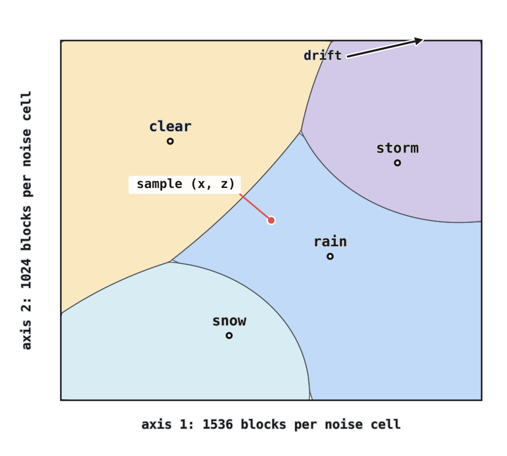

# Weather

Weather in Voxelius belongs to a world, not to an entity. The server owns a weather seed and a weather clock per world. The seed travels once in `World_Info`, and the clock travels in `World_Timings` every tick. Both sides derive the same field from that pair and a world position, so the server sends no per-position weather state.
`World_Info` also carries the list of weather types that the world allows, and an empty list allows every type.

## Registering a type

```lua
weather.add("thunderstorm", {
  intensity = 1.0,
  sky_tint = { 0.14, 0.16, 0.19 },
  sky_visibility = 0.05,
  light = 0.35,

  cloud = {
    height = 160,
    thickness = 64,
    opacity = 0.95,
    scale = 112,
    coverage = 1.0,
    shadow = { 0.84, 0.85, 0.88 },
    lit = { 0.97, 0.98, 1.00 },
    seed = 19,
  },

  precip = {
    types = { "rain", "snow", "dry" },
    intensity = 1.0,
  },

  strikes_per_minute = 6.0,
  strike_radius = 96.0,

  target = { 0.82, 0.55 },
  weight = 1.0,
})
```

`weather.add` returns the type id and raises a Lua error when the definition is rejected. It follows the same rules as `biomes.add`: the name is relative to the calling mod, and the type id is stable for the whole session. Every world shares the registry, so a mod can add a type that every world can pick.

## Where the weather is

Two drifting noise grids form the two axes of a climate square:

- the engine samples the **first axis** (1536 blocks per noise cell) and the **second axis** (1024 blocks per noise cell) at the point. Both drift with the world's wind
- every type owns a **target point** in that square (`target = { a, b }`, each from 0 to 1)
- at a point, each type's score is the squared distance from the sample to its target, divided by its `weight`, with the weight floored at 1. The score also floors at a tiny value. The type with the lowest score is the type at that point
- the types share the point with a soft blend that drops off quickly away from the nearest target. A type owns its cell almost entirely. Only a narrow band mixes two types, so a change of type is a gradient without a world-wide haze
- the share also picks the sky tint, the visibility and the light. `intensity` does not dilute that mix, it only scales the cloud coverage

The figure shows four targets in the climate square. Each target owns the point nearest to it, and the sample point takes the type of its target.



Because targets are points rather than positions on one ordered line, a storm can border a clear sky directly. Where the types sit relative to each other is a data decision, not an engine one. In the shipped content the storm sits next to the clear and the rain targets. Overcast lies close to the line between them, so a front can still pass through it.

The square drifts with the world's wind. The wind direction and speed come from the weather seed. A type does not set them. The field is two-dimensional and does not depend on height.

## The weather clock

The server advances `weather_tick` once per fixed tick while the replicated gamerule `gr_weather_cycle` is on. `World_Timings` carries that value to each client of the world. A client advances its own copy of the tick between packets, so a late packet does not freeze the sky. The client takes the packet as the correction. A jump of more than a second is a forced front, a rewound clock or a world switch. The client snaps to it and rebuilds the cloud deck instead of sliding the old one across the sky.

The weather and precipitation definitions travel as part of the mod content, and the login checksum covers both registries. The only per-world weather data the server sends is the seed, the clock and the list of allowed types. The weather seed travels in `World_Info`, and the clock in `World_Timings`.

## Where the engine keeps the weather

The field belongs to the world, not to the session. Each world keeps its weather seed and weather clock in its own `world.conf`, next to its daylight clock:

```ini
weather.seed=12345678901234567890
weather.tick=0
daylight_tick=7200
```

The engine rolls the seed from the system randomness when the world config has no `weather.seed`, and writes the value when the world is saved at shutdown. The seed does not come from the world seed, and it says nothing about the terrain. A client can therefore receive the seed without learning how the engine generated the world. A world that is never saved keeps rolling a new seed on every start. Deleting the keys, or the file, gives that world a fresh sky.

`weather_force <type>` advances the world's weather clock to the next tick at which the requested type covers the players, up to seven days of the weather clock ahead, which is about five hundred in-game days at the default day length. The client sees the jump and rebuilds its deck. The `wind` field of an old definition no longer exists. A script that still passes it loads, and the engine ignores the value.

## Fields

| Field | Type | Default | Meaning |
|---|---|---|---|
| `intensity` | number | `1.0` | Overall strength. It scales the cloud coverage and the climate bias |
| `sky_tint` | RGB | white | Color that replaces the sky where `sky_visibility` is low. The fog takes the horizon color of the resulting gradient |
| `sky_visibility` | number | `1.0` | How much of the clear sky shows through, from `0` (only `sky_tint`) to `1` (the Rayleigh gradient). The sun, moon and stars fade with its square |
| `light` | number | `1.0` | Multiplies the sky light the world receives |
| `cloud` | table | none | The cloud body of the type. A zero coverage leaves the sky clear |
| `precip` | table | none | Precipitation front. It names the types and the intensity. See the [precipitation API](precip.md) |
| `target` | two numbers | `{0.5, 0.5}` | Point this type owns in the climate square, each axis from 0 to 1 |
| `weight` | number | `1.0` | How far this type's cell reaches from its target. A bigger weight means the type covers more of the world |
| `strikes_per_minute` | number | `0.0` | How often the type strikes |
| `strike_radius` | blocks | `96.0` | Strike scatter around a player |

### Climate

The sampled front and its coverage also move the local climate. A front that names precipitation types lowers `world.get_temperature` by up to two degrees Celsius and pushes `world.get_humidity` towards 0.98, both scaled by the coverage of the front there. A roof stops the change: a point at or below the top of its column keeps the biome base. The coverage term follows any front that names precipitation types, whatever type owns the point. A type without precipitation of its own still cools a point that sits inside such a front.

### Cloud body

| Field | Default | Meaning |
|---|---|---|
| `height` | `192` | World Y of the bottom of the cloud volume |
| `thickness` | `8` | How tall the volume is, in blocks. The client divides it into whole voxels |
| `opacity` | `0.9` | How opaque the deck is where the field covers it |
| `scale` | `128` | Blocks per noise tile. It controls the size of the cloud masses |
| `coverage` | `0` | Base density, 0 to 1 |
| `shadow`, `lit` | gray | Color of the underside and of the top |
| `seed` | `0` | Changes the noise pattern |

A type has one cloud body, not a stack of layers. A storm and a clear sky
differ in `height`, `thickness` and `coverage`, not in how many slabs they
declare. The body is not a plane. The client samples the noise field on the
grid of the ring it is meshing. It turns each cell whose density clears the
body's coverage into a column of whole voxels, one or more of them. A dense
front grows the column towards `thickness`, and the shell noise breaks its
top into heaps. A storm fills its volume, while a thin type stays a sheet.
The client meshes the deck in rings that tile the range. The cells are 8
blocks out to 32 chunks, 32 blocks out to 96 and 128 blocks out to 256. A
longer range therefore extends the deck outwards instead of growing the
blocks under the player. Rings overlap by two cells, so the seam between two
of them never opens. A column stays inside the body's slab, from `height` up
to `height + thickness`. Every column also carries its own slightly varied
shade, a few percent off its neighbours. A dense deck therefore reads as
blocks instead of one flat sheet. The client lights the body from the sun and
the sky. `shadow` and `lit` are the albedo of the underside and the top, not
the final color, and the fog takes over with distance. The client meshes only
the faces that the neighbours leave exposed, so a dense deck costs less than
its area. The deck dissolves into the sky at its own edge instead of ending
on a rim. It reaches the composite as one more depth-sorted layer.

## Precipitation front

A type that can show precipitation names one or more [precipitation types](precip.md):

```lua
precip = {
  types = { "rain", "snow", "dry" },
  intensity = 1.0,
}
```

`types` lists the precipitation type IDs that the front can carry. It defaults to an empty list, which means the type carries no precipitation. A name without a namespace is relative to the calling mod. The engine resolves the names when the weather type commits. It drops a name that is not registered at that point and logs a warning. The old `precipitation` table is gone. A script that still passes it loads, and the engine ignores the value.

`intensity` scales the amount at full coverage. It defaults to 0.0, so a front without it shows nothing.

The front shares its point with the neighbours, and that share scales the amount. When a front covers a block, the engine scores each type in the front from the effective temperature and the base humidity of the block. The type with the highest score wins. If no type scores, the front shows no precipitation. A roof stops the precipitation.

## Callbacks

All callbacks run on the server, in the mod's Lua state.

| Callback | Arguments | When |
|---|---|---|
| `on_tick` | `tick` | Once a second for the type under the players |
| `on_strike` | `x`, `z`, `y` | A thunder strike landed |

The engine logs a strike before `on_strike` runs. There is no bolt yet: the callback is the hook for a mod that wants one.

There is no per-type duration or transition schedule. A type owns the climate space nearest its target, and the weather under a player changes when the drifting field brings another cell over them. A bigger `weight` therefore means the type covers more of the world.

## Querying

```lua
local state = weather.state()
-- state.seed, state.tick, state.wind_x, state.wind_z, state.wind_speed

local sample = weather.sample(x, z)
-- sample.coverage, sample.type, sample.precip

local precip = weather.precip_at(x, y, z)
-- precip.type, precip.amount
```

`sample.precip` is the front intensity multiplied by its coverage at the point. It is `0` when the type has no precipitation types.

`precip.type` is `precip.NULL_TYPE` when no type fits or a roof covers the block. `precip.amount` is the amount that the front carries at the block, from 0 to 1.

`weather.sample` and `weather.force` take the block X and Z: the field is two-dimensional and does not depend on height. `weather.precip_at` takes the block X, Y and Z, because the type selection also depends on the local climate and on the cover above the block.

`weather.force` exists on the server only. The field is absent on the client.

`weather.force("builtin:rain", x, z)` advances the weather clock until the requested type covers the point. On the server the `weather_force` command does the same around the players.
