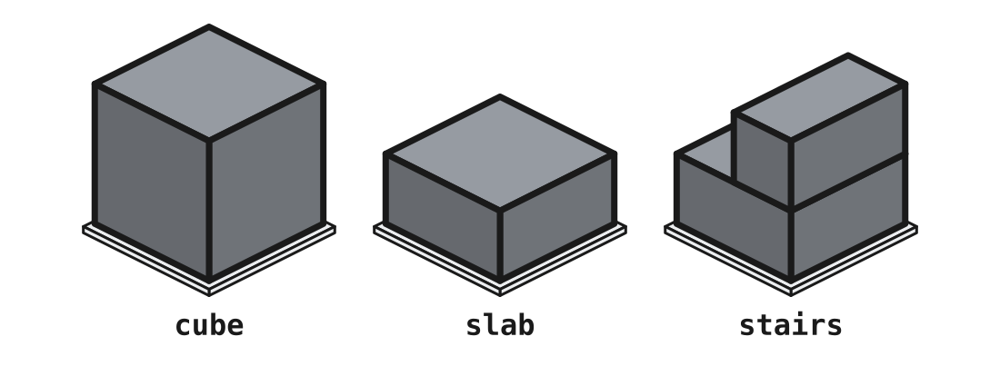

# Block Collisions

Block collisions define the physical shape of a block. The engine uses the shape for collision, movement and selection. The `collidable` and `selectable` fields of the [block definition](../api/blocks.md#block-definition) decide whether the engine uses the shape for physics and for raycasts. These models are separate from render geometry.

Lighting reads the same shape. A cell face counts as covered when the collision bounds reach that face and fill the cell
on both perpendicular axes. A shape whose bounds fill the cell closes all six faces, even when its geometry has a notch,
which is what a stairs shape does. A slab closes its bottom face only, so light passes through its sides and its top.

Block collisions live under: `namespace:collisions/block`

## Top-level fields

|Field|Type|Required|Default|Description|
|----|----|----|----|----|
|`elements`|`object[]`|yes|N/D|List of axis-aligned boxes that form the model. An empty list gives a shape with no boxes|

## Element object

|Field|Type|Required|Default|Description|
|----|----|----|----|----|
|`min`|`number[3]`|yes|N/D|AABB start in 1/16ths of a block|
|`max`|`number[3]`|yes|N/D|AABB end in 1/16ths of a block|

## Examples

The figure shows the three shapes that follow. Each shape fills its cell in a different way.



### Example: cube collision

```json
{
  "elements": [
    {
      "min": [0, 0, 0],
      "max": [16, 16, 16]
    }
  ]
}
```

### Example: slab collision

```json
{
  "elements": [
    {
      "min": [0, 0, 0],
      "max": [16, 8, 16]
    }
  ]
}
```

### Example: stairs collision

```json
{
  "elements": [
    {
      "min": [0, 0, 0],
      "max": [16, 8, 16]
    },
    {
      "min": [0, 8, 0],
      "max": [8, 16, 16]
    }
  ]
}
```
