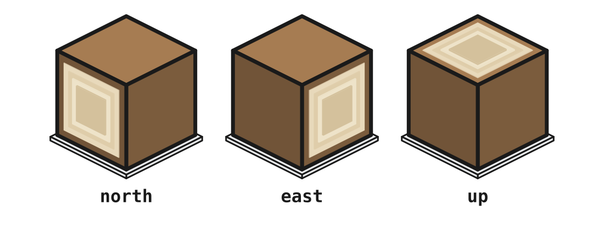

# Logs library

The `builtin:logdef` library gives helpers for registering log-like blocks.

## Importing

```lua
local logdef = require("builtin:logdef")
```

### Function: `logdef.on_place(identifier) -> function`

This function returns an `on_place` callback for a given log identifier.

#### Arguments

- `identifier` is accepted for symmetry and is not read. Only `add_block` resolves a namespace.

#### Return value

- A function that implements log placement logic for block registration

### Function: `logdef.add_block(identifier, prototype) -> integer`

A wrapper around `blocks.add` that defines a log block family.

#### Arguments

- `identifier` is the namespaced block ID. If you omit the namespace, the engine uses `core.NAMESPACE`.
- `prototype` is the base block definition the function builds on

#### Return value

- Numeric block ID

#### Notes

The figure shows one log with the grain along the Z, the X and the Y axis. The rings show on the cut face.



- The registered block family gets an `orientation` state and variants for `north`, `east`, and `up`.
